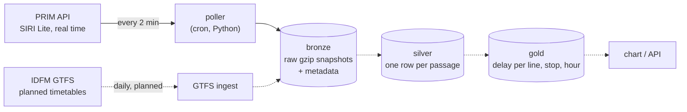

# Paris Transit Reliability

**How reliable is public transport in Paris?** This project compares what Île-de-France Mobilités **plans** (GTFS timetables) with what **actually happens** (real-time SIRI Lite passages from the PRIM API), to measure delays per line, per stop and per hour of the day.

> **Status:** in progress. Ingestion (Level 1) has run  since 2026-10-15. Cleaning (Level 2) is being built now.

## Architecture



Solid lines are running today; dotted lines are being built.

- **Kappa-style:** the bronze files are the log. One processing path reads new files after a checkpoint, and history is rebuilt by replaying bronze through the same code ([ADR-0001](docs/adr/0001-overall-data-architecture.md))
- **Medallion layers:** bronze (raw, as received), silver (clean rows), gold (metrics)
- **Storage through `fsspec`:** plain files on the server today; switching to S3 is a configuration change, not a rewrite ([ADR-0003](docs/adr/0003-bronze-storage-plain-files-fsspec.md))
- **Runs on one free server:** Oracle Cloud Always Free (Arm, 2 OCPU, 12 GB RAM). Budget: zero

## Ingestion (Level 1)

Every 2 minutes, the poller requests the **full real-time snapshot** of the network (`/estimated-timetable?LineRef=ALL`) and stores it **exactly as received**:

```
bronze/prim_global/date=2026-10-16/hour=05/20261016T051401Z.json.gz     raw gzip bytes from PRIM
bronze/prim_global/date=2026-10-16/hour=05/20261016T051401Z.meta.json   request time, status, durations, size, sha256
```

- Partitioned by `date=` and `hour=` (UTC), filenames in ISO 8601 basic format, so they sort as text
- **Atomic writes** (`fs.transaction`): a dropped download never leaves a half file
- **SHA-256** of the stored bytes, computed while streaming
- 720 requests a day, under the API quota of 1,000

### Measured so far

| Measure | Value |
|---|---|
| Completeness over 8 full days (Oct 16 to 23) | **99.76%** (5,746 of 5,760 snapshots) |
| Failures | 13 connections dropped mid-download, 1 HTTP 502 from Cloudflare, all at rush hours |
| Time to first byte (8,499 runs) | median 0.46 s, p99 2.1 s |
| Full download (8,499 runs) | median 3.7 s, p99 17.1 s, max 40.7 s |
| Bronze size | ~2.4 GB a day gzipped (weekday 2.5 to 2.9 GB, Sunday 1.4 GB) |
| Snapshot size | ~0.3 MB at night, ~6.5 MB at the 07:00 peak (gzipped) |

These numbers drove the next design: retries with exponential backoff and jitter, a 90 s deadline per run, a daily retry budget so the quota can never be exceeded, and a failure record for every run ([ADR-0004](docs/adr/0004-poller-retries-and-failure-records.md)).

## Design decisions

Every significant choice is written down as an Architecture Decision Record, with the options considered and the condition for reversing it: [docs/adr](docs/adr/README.md).

| ADR | Decision |
|---|---|
| [0001](docs/adr/0001-overall-data-architecture.md) | Kappa over Lambda: one processing path, history by replay |
| [0002](docs/adr/0002-bronze-snapshots-and-changes.md) | Raw snapshots for 7 days, then hourly keyframes + changes |
| [0003](docs/adr/0003-bronze-storage-plain-files-fsspec.md) | Plain files through fsspec, not an S3 server (MinIO's open-source edition is no longer maintained) |
| [0004](docs/adr/0004-poller-retries-and-failure-records.md) | Retries, timeouts, retry budget and failure records |

## Roadmap

| Level | What | Status |
|---|---|---|
| 1. Bronze | poller, raw storage, measurements | running; retries (ADR-0004) next |
| 2. Silver | GTFS ingestion, parse snapshots into rows, deduplicate, compaction | in progress |
| 3. Gold | first metric (delay per line and hour) and one chart | planned |
| 5. Streaming | broker, same processing logic | planned |
| 4. Prediction | delay prediction model | planned |
| 6. MLOps | serving, monitoring, retraining | planned |

## Run it

Requirements: Python 3.12, [uv](https://docs.astral.sh/uv/), a free [PRIM](https://prim.iledefrance-mobilites.fr/) API key.

```bash
git clone https://github.com/ChaimaGharbi/paris-transit-reliability.git
cd paris-transit-reliability
uv venv && uv pip install requests python-dotenv fsspec pytz
```

Copy the example file and fill in the values:

cp .env.example .env

```dotenv
BASE_URL=https://prim.iledefrance-mobilites.fr
BASE_PATH=/marketplace
PRIM_API_KEY=your-key
BRONZE_ROOT=file:///absolute/path/to/data/bronze
```

Run once, then schedule it:

```bash
.venv/bin/python poller.py
# crontab -e
*/2 * * * * cd /path/to/paris-transit-reliability && .venv/bin/python poller.py >> /path/to/poller.log 2>&1
```

Timing statistics over everything collected: `.venv/bin/python scripts/timing_stats.py`

## Data and licence

Data: **Île-de-France Mobilités**, via [PRIM](https://prim.iledefrance-mobilites.fr/) and [transport.data.gouv.fr](https://transport.data.gouv.fr/datasets/reseau-urbain-et-interurbain-dile-de-france-mobilites), under the [Open Database License (ODbL)](https://opendatacommons.org/licenses/odbl/). Collected data is not published in this repository.
Code: MIT, see [LICENSE](LICENSE).
