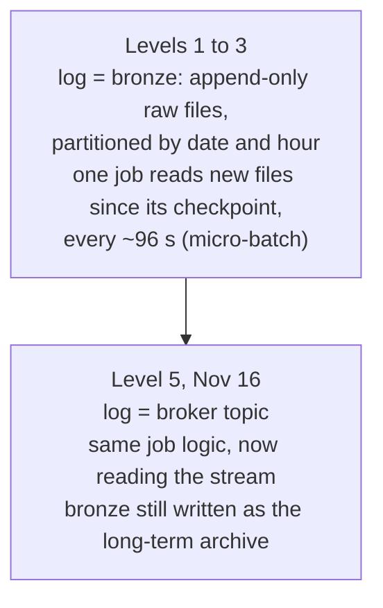

# ADR-0001: Overall data architecture

- **Status:** accepted
- **Date:** 2026-10-14

## Context

The system collects real-time passages from PRIM (SIRI Lite, one global snapshot every ~96 s, 48 MB raw each) and planned timetables from IDFM GTFS (republished 3 times a day). It must serve four kinds of readers:

| Reader | Freshness | How far back |
|---|---|---|
| Live dashboard and live delay prediction | **seconds** | minutes to today |
| Delays filtered by line, stop, operator | seconds (live view), daily (history view) | today to a month |
| Reliability per line, stop, time of day (dashboard + API) | daily to weekly | **a month or more** |
| Delay model training | weekly (retrain cycle) | **months** |

These readers pull in **opposite directions**. If the cleaned data is rebuilt once a night, live prediction at 17:40 reads yesterday's data. Recomputing months of history every few seconds is far too expensive. The architecture must serve both speeds.

## Decision drivers

- **Two speeds from the same data:** seconds-fresh for live use, months of history for reliability and training
- **Solo developer:** every piece of logic written twice is maintained twice
- **Reprocessing:** a cleaning bug or a new question must be fixable by rebuilding from raw data (raw is kept)
- **Roadmap order:** batch levels first (1 to 3), streaming at Level 5 (Nov 16), prediction at Level 4 (Dec 5)
- **Zero budget:** one free server, Oracle Cloud Always Free (Arm, 2 CPUs, 12 GB RAM, 200 GB disk); bronze is ~3.6 GB/day gzipped

## Options considered

### Option 1: Kappa (one stream path, replay for history)
- Pros: **one codebase, one logic**; reprocessing = replay the log through the same code; low latency for everything
- Cons: the log must keep every event for as long as history is needed; replaying months can be slow; stream processing is harder to debug than batch

### Option 2: Lambda (batch path + speed path, merged in a serving layer)
- Pros: full batch recomputes give strong accuracy and self-heal speed-layer errors; mature pattern
- Cons: **the same logic written twice** and kept in sync; more systems to run; the merge adds complexity

### Option 3: Batch only
- Pros: simplest; no stream infrastructure at all
- Cons: the freshest data is the **last batch run**, so the live dashboard and live prediction are always behind. Calling PRIM directly on each dashboard request would spend the quota and give no history.

## Decision

Chosen option: **Kappa**.

- **Why not Lambda:** I am a solo developer. Lambda means writing and maintaining the same parsing and cleaning logic twice, in a batch job and a stream job, and keeping them in sync.
- **Why not batch only:** it cannot feed the dashboard and the prediction with live data.
- **Why Kappa:** one processing path serves both speeds. History is rebuilt by **replaying** the raw log through the same code.

### Evolution by level

- **Levels 1 to 3:** the **bronze folder is the log**. Each raw response is a new, never-modified file. The one processing job remembers the last file it processed (a **checkpoint**) and handles only newer files, every ~96 s. A replay is the same job started from the first file.
- **Level 5:** the log moves to a **broker**, and the job reads from it continuously.
- **Must not change:** the **parse and clean logic** (one shared library, used in every mode) and **raw data is always kept** in bronze, because broker retention is limited.

## Consequences

- Positive: the parse and clean code is written and maintained **once**; any bug is fixed by replaying bronze; moving to streaming at Level 5 changes the source, not the logic.
- Negative: keeping the full raw log costs storage; replay time grows as history grows; stream concepts (checkpoints, state, late data, watermarks) are harder to learn and debug than plain batch.
- Risks: late or out-of-order snapshots (network gaps, retries) must be handled by the one path, since no batch job corrects them later; a bug in the one path affects every reader at once (mitigation: replay drill, NFR-B4).

## Reversal trigger

I will reconsider Lambda (a separate batch recompute for history) **if replaying 30 days of bronze into silver takes more than 8 hours** on the project server, meaning it no longer fits in one night.

## After measurement

Filled in once built: replay time per day of bronze, disk usage per day, end-to-end lag.

## Links

Related: [ADR-0002](0002-bronze-snapshots-and-changes.md)
Sources: [Questioning the Lambda Architecture, Jay Kreps](https://www.oreilly.com/radar/questioning-the-lambda-architecture/) · [Lambda vs Kappa (GeeksforGeeks)](https://www.geeksforgeeks.org/system-design/lambda-architecture-vs-kappa-architecture-in-system-design/)
