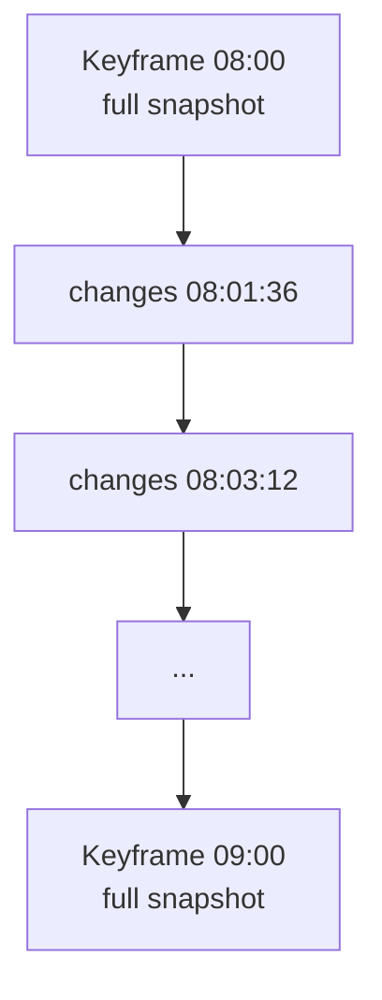

# ADR-0002: Snapshot vs change storage (bronze)

- **Status:** superseded
- **Date:** 2026-10-14
- **Superseded by:** [ADR-0006](0006-bronze-hourly-zstd-archives.md)

> [!WARNING] Superseded on 2026-11-18 by [ADR-0006](0006-bronze-hourly-zstd-archives.md)
> Measured journey-level changes were **32% of a full snapshot** (median, 116 pairs), above this ADR's own 30% trigger. Hourly zstd archives measured **18 to 22%** with no diff code.

## Context

[ADR-0001](0001-overall-data-architecture.md) chose Kappa: **bronze is the log**, and history is rebuilt by replaying it. So bronze must keep **everything needed to rebuild the past**, for as long as history is needed.

The poller takes one global snapshot every ~96 s (~900 a day). Measured on 2026-10-08:
- one snapshot: 48 MB raw, ~4 MB gzipped
- full snapshots, gzipped: **~3.6 GB a day, ~110 GB a month**
- server disk (Oracle Cloud Always Free): **200 GB**, so full snapshots fill it in about 7 to 8 weeks (shared with silver, gold and the OS, so less in practice)

Two snapshots 96 s apart are mostly identical: most passages did not change.

## Decision drivers

- **Replayable history:** bronze must allow a full replay (ADR-0001)
- **Storage:** must fit the free server's disk; the budget is **zero**
- **Safety:** a bug in my own code must never destroy raw data
- **Completeness:** gaps must be detectable (NFR-B1, NFR-B3)
- **Speed:** the poller must start running now; this decision must not block it

## Options considered

### Option 1: Store every full snapshot
- Pros: simplest; truly raw; any snapshot can be read alone
- Cons: ~110 GB a month; disk full in ~3 weeks; ~95% of the bytes are repeats

### Option 2: Store only the changes between snapshots
- Pros: much smaller (exact ratio to measure)
- Cons: **the diff is computed by my code**: a diff bug silently loses data forever; to rebuild a moment, you must apply every change since the start; one lost change file breaks everything after it

### Option 3: Periodic full snapshots + changes in between (keyframes)
Like video compression: a full **keyframe** now and then, small **changes** between keyframes.

- Pros: small; a replay can start at any keyframe; a lost change file only damages data until the next keyframe; keyframes let me **check** that keyframe = previous keyframe + all changes (completeness and diff-bug detection)
- Cons: two file types to handle; the diff is still my code

## Decision

Chosen option: **Option 3 (keyframes + changes), with a raw safety window.**

1. **Hot window:** every full snapshot is kept **raw and gzipped for 7 days**. If the diff code has a bug, I can fix it and recompute the changes from raw.
2. **Long-term:** after 7 days, a compaction job turns raw snapshots into **one keyframe per hour + changes** in between, then deletes the raw files.
3. **Check before delete:** raw files are deleted only after the compaction check passes (keyframe rebuilt from changes = real keyframe).

### What counts as a "change"

A passage is identified by its natural key (vehicle journey + stop, exact fields to fix in Level 2). It is a change when it **appears, disappears, or one of its fields changes** (expected time, status...).

### By level

- **Level 1 (now):** store full gzipped snapshots only. The poller does no diffing. Measure the real change ratio.
- **Level 2 (by Nov 1, well before the disk is full):** build the compaction job and the check.
- **Amended 2026-11-11:** the Nov 1 date was missed. Compaction is now planned for **Nov 17 to 18**, after the silver job. Not a risk yet: bronze grows ~2.4 GB/day and was 29 GB on Oct 27 (rsync total), so roughly 65 GB by Nov 11 and the disk lasts until about early January. Confirm with `df -h` on the VM.

## Consequences

- Positive: storage drops from ~110 GB a month to (to measure); raw data is protected for 7 days; the poller stays simple.
- Negative: two formats in bronze; replays must apply changes on top of keyframes; bronze is no longer 100% "as received" after 7 days.
- Risks: a diff bug found **after** 7 days cannot be fixed from raw (mitigation: the keyframe check runs before any delete); the disk fills before Level 2 if compaction is late (mitigation: disk alert at 70%).

## Reversal trigger

- If changes are **more than 30% of a full snapshot** on average, the gain is too small: keep full snapshots and find more storage (B-02), since the budget is zero.
- If the compaction check fails more than once a week, extend the raw window or go back to full snapshots.

## After measurement

**2026-10-16 (partial, first night, polling every 2 min = 720/day):**
- Full gzipped snapshot size depends on the time of day: ~0.3 MB at night, ~6.5 MB at the morning peak (07:00 to 08:00 Paris)
- Bronze per hour (Oct 16, UTC): 8.6 MB at 00h, 196 MB at 05h (peak), 90 MB at 09h (partial)
- Oct 15 (21:20 to 24:00 UTC, night): 68 MB · Oct 16 (00:00 to 09:40 UTC): 1.2 GB
- First estimate: **2.5 to 3.5 GB/day** (lower than the 3.6 GB/day guessed on Oct 8). Full-day figure: Oct 17.

**2026-10-17: first full day (Friday Oct 16, UTC):**
- **2.9 GB/day** of full gzipped snapshots, 719 of 720 runs (1 dropped connection)
- Two peaks: **196 MB at 05h UTC (07:00 Paris)** and **217 MB at 15h UTC (17:00 Paris)**; minimum 8.6 MB at 00h UTC
- Disk: 187 GB free → **~64 days** at weekday rate. Raw window (7 days) ≈ 20 GB: fits easily
- PRIM `ResponseTimestamp` was 27 s older than the request: PRIM regenerates on its own cycle, so polling faster than that cycle creates duplicates. Measure with sha256.

Still to measure:
- average change size vs full snapshot size: needs the diff code (Level 2)
- bytes per day: full snapshots ..., keyframes + changes ...: needs the diff code (Level 2)
- compaction check failures: needs 2 weeks of compaction in production

**2026-11-18: measured, trigger hit.** `scripts/measure_changes.py` on Mon Nov 16 (hours 05, 12, 15, 23 UTC, 116 pairs): journey-level changes = **median 32.2%, mean 33.3%, max 46.3%** of a full snapshot (night 42%, morning peak 26%); ~35% with one keyframe per hour. **Above 30%: reversal trigger reached.** About 45% of journeys change every 2 minutes, so "mostly identical" was wrong at journey level. Replaced by [ADR-0006](0006-bronze-hourly-zstd-archives.md) (hourly zstd archives: 18 to 22%).

## Links

Related: Previous: [ADR-0001](0001-overall-data-architecture.md)
