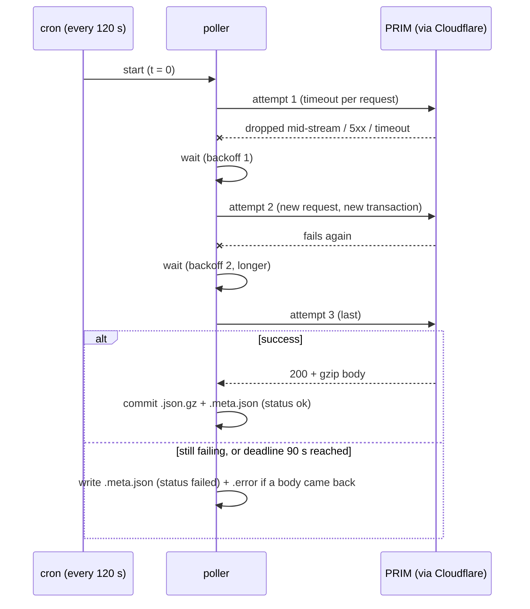

# ADR-0004: Poller retries and failure records

- **Status:** accepted
- **Date:** 2026-10-24
- **Amended:** 2026-11-11

## Context

After 8 full days of polling (Oct 16 to 23, cron every 2 min = 720 runs/day), the Poller captured **5,746 usable snapshots out of 5,760 (99.76%)**. The 14 losses:

| Count | Failure | Detail |
|---|---|---|
| 13 | `urllib3.exceptions.ProtocolError: Response ended prematurely` | connection dropped **mid-download**, clustered at rush hours (04 to 06 and 13 to 14 UTC) |
| 1 | HTTP **502** (Oct 23, 09:46 UTC) | Cloudflare JSON error: *"origin ... overloaded or misconfigured"*. Body **not gzip**, but saved as `.json.gz` |

Problems found:
- a failed run leaves **no record in bronze** (only a Traceback in `poller.log`): gaps are hidden (NFR-B3)
- an error body was stored under the **data filename**: silver would crash on it
- `requests.get` has **no timeout**: one stuck connection could hang a run for minutes
- no retry: every transient drop loses a snapshot

Facts that shape the design: PRIM is **behind Cloudflare**; the origin seems to struggle at peak hours; quota is **1,000 requests/day**; runs start every **120 s**; one attempt (headers + body) takes 3.7 s at the median and 17.1 s at p99, 40.7 s at worst (measured on 8,499 runs, see "Timeout sizing").

## Decision drivers

- Never overlap the next run (cron every 2 min)
- Never breach the daily quota, even during a whole-day outage (NFR-B2)
- Do not hammer an origin that is already overloaded
- Every run leaves a record: success or failure (NFR-B3)
- A filename must tell the truth about its content

## Options considered

### Retries
- **No retry:** simple, but loses every transient drop (13 in 8 days)
- **Fixed count, fixed delay** (e.g. 5 tries, 10 s apart): with 5 tries a whole-day outage = 720 × 5 = **3,600 requests** (quota gone by ~05:30 UTC); fixed fast retries add load to an overloaded origin
- **Few retries + exponential backoff + deadline + daily retry budget** (chosen)

### Failure records
- **Separate error log file:** Level 2 must look in two places to know if and why a snapshot is missing
- **Failure record in bronze, same folder and timestamp name** (chosen): completeness of an hour = one folder listing

### Error bodies
- **Drop them:** loses evidence (e.g. Cloudflare `ray_id`)
- **Keep under the data name, flag in metadata:** every reader must open the file to know what it is
- **Keep under their own name** (chosen)

## Decision

### Retry policy



- **Max 2 retries** (3 attempts per run); the last attempt gets whatever time is left before the deadline, and is skipped if under 5 s
- **Exponential backoff** between attempts (~5 s, then ~10 s), with a little random jitter
- **Timeout on every request:** `(connect, read) = (5 s, 15 s)`, see "Timeout sizing"
- **Deadline: 90 s after the run starts.** No new attempt after it; leaves 30 s margin before the next run
- **Retry on:** dropped connection (`ProtocolError`), timeout, 5xx, 429. **No retry** on other 4xx (our mistake, retrying will not fix it)
- **Each attempt = new request + new `fs.transaction`**: a dropped stream cannot be resumed; the transaction already discards partial files (proven Oct 16)

### Timeout sizing (decided 2026-11-11)

Measured with Timing Stats on 8,499 runs (Oct 15 to 27):

| | median | p99 | max |
|---|---|---|---|
| time to headers | 0.46 s | 2.1 s (worst hour 4.2 s, 15 UTC) | 8.7 s |
| headers + body | 3.7 s | 17.1 s | **40.7 s** |

- **connect = 5 s:** opening a connection is fast; 5 s only absorbs network hiccups
- **read = 15 s:** about 3.5× the worst hour's p99 time to headers (4.2 s), above the worst header time ever seen (8.7 s); also tolerates stalls between body chunks
- **Per attempt: 25 s**, enforced by the poller's own clock, because the read timeout limits **silence between bytes**, not total time: (90 s − 5 s − 10 s waits) ÷ 3 attempts = 25 s
- **Accepted loss:** an attempt still downloading at 25 s is stopped. About 1% of attempts exceed 17 s (p99), and the slowest seen took 40.7 s. Whether these are big snapshots (retry just as slow) or a slow server (retry may be faster) was **not** classified: the investigation was stopped to keep the project on schedule. To check after deploy (see "After measurement")

### Daily retry budget

```
1,000 quota − 720 normal runs = 280 headroom
→ retry budget ≈ 230/day, ~50 kept as safety margin
```
- Keep a counter of today's requests. When the retry budget is used up, **stop retrying** for the rest of the day: every run still makes its **one normal attempt**, so snapshots keep coming; only failed ones lose their second chance
- The counter must reset at the **same moment as PRIM's quota**: **midnight UTC** (deduced 2026-10-24: PRIM showed 338/1000 at 11:15 UTC = 11.25 h × 30 runs/h = 337.5 since midnight UTC; midnight Paris would give ~398)
- Stay at **2-minute polling** for now: at 96 s (900/day) the retry budget would shrink to ~50/day. Revisit after measuring duplicates between consecutive snapshots

### Files in bronze (same folder, same timestamp name)

| File | When | Content |
|---|---|---|
| `<ts>.meta.json` | **every run**, success or failure | metadata + `status` (`ok` / `failed`), attempts, last error |
| `<ts>.json.gz` | only status 200 **and** body is gzip | raw gzip bytes as received |
| `<ts>.error` | the run failed and an error body came back (e.g. 502, 403) | error body as received, decoded, max 1 MB. Neutral extension: bodies can be JSON (Cloudflare 502) or HTML (Cloudflare 403 block page, seen 2026-11-14); the meta records `content_type` |

Failure metadata fields: request time (UTC), `status: failed`, number of attempts, `stopped_because` (deadline / retry budget), last error type and message, last HTTP status if any, `content_type`, Cloudflare `ray_id` (from the `cf-ray` header) if any, total duration, retries used today.

Completeness of one hour = count `.meta.json` files (30 expected) and how many have `status: ok`.

Note for readers of v1 files (written before this ADR): they have no `status` field. Derive it from `status_code` (200 → ok, anything else → failed). The Oct 23 502 run wrote a `.meta.json` with `status_code: 502`.

- `size_in_bytes` is the size of the **data file only**, `None` when the run failed

## Consequences

- Positive: transient drops recovered within the same run; quota can never be breached by retries; every gap visible in bronze; silver can safely read every `.json.gz`
- Negative: more code paths (retry loop, counter, three file types); counter state must live somewhere (file on disk) and survive reboots; ~1% of slow downloads are cut at 25 s
- Risks: backoff waits push a run close to the next one (mitigation: 90 s deadline); counter reset at the wrong hour (mitigation: check PRIM's reset time); two runs overlapping if cron fires while one is still running (mitigation: deadline; optionally a lock file)

## Reversal trigger

- If retries recover **less than half** of failed runs after 2 weeks, the failures are not transient: drop retries to 1 and investigate (e.g. ask PRIM with `ray_id`s)
- If the retry budget is exhausted on **more than 2 days a week**, revisit the polling interval or the budget split
- If more than **1% of runs** end with "stopped at 25 s", classify them (size and throughput vs the hour's median) and rebalance attempts, waits and deadline

## After measurement

**Interim, 2026-11-17 (v2 live since 2026-11-14 18:52 UTC, 3 days):**

| | v1 (Oct 16 to 23, 8 days) | v2 (Nov 14 to 17, 3 days) |
|---|---|---|
| runs | 5,760 | 2,100 |
| lost snapshots | 14 (0.24%) | 0 |
| runs that needed a retry | n/a | 14 (all succeeded on attempt 2) |
| runs that needed a 3rd attempt | n/a | 0 |
| retry budget used | n/a | ~5 a day of 230 |

- Recovery rate **100%** (reversal trigger: below 50%): far from the trigger
- First v2 run: 3.5 MB in 15.5 s (0.23 MB/s) at 18:52 UTC Saturday: a slow-server case, not a big snapshot (a 7.5 MB snapshot downloaded in 3.9 s the day before)

To fill in after 2 weeks: same table over 14 days, max run duration, budget exhaustion days, runs stopped at 25 s.

## Links

Related: Previous: [ADR-0003](0003-bronze-storage-plain-files-fsspec.md)
