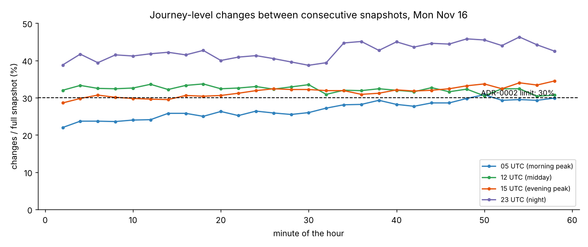
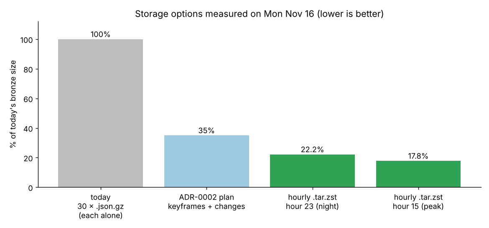
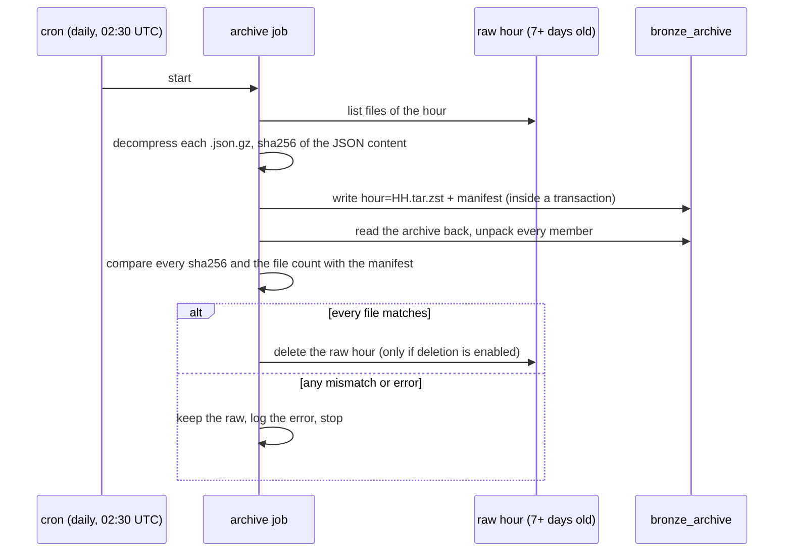

# ADR-0006: Long-term bronze storage: hourly zstd archives

- **Status:** accepted
- **Date:** 2026-11-18
- **Supersedes:** [ADR-0002](0002-bronze-snapshots-and-changes.md)

## Context

[ADR-0002](0002-bronze-snapshots-and-changes.md) chose **keyframes + changes** for bronze after a 7-day raw window, with one reversal trigger: **if changes are more than 30% of a full snapshot, the gain is too small**. It assumed that two snapshots 2 minutes apart are "mostly identical".

By 2026-11-18 bronze is about **83 GB** and grows **~2.4 GB a day** (2.5 to 2.9 GB on weekdays, 1.4 GB on Sundays). The VM disk would be full around early January, and the same VM must also host Projects A and C.

So I measured the change ratio before building anything.

### Measurement 1: journey-level changes (2026-11-18)

Script: `scripts/measure_changes.py`. It reads consecutive snapshots, matches vehicle journeys by `DatedVehicleJourneyRef`, counts journeys **added, removed or modified**, and compares the size of a gzipped "changes" file with the full gzipped snapshot. Run on the VM for **Monday Nov 16**, hours 05, 12, 15 and 23 UTC (116 consecutive pairs, 2 min apart).



| Hour (UTC) | Journeys in snapshot | Modified per 2 min | Changes / full snapshot (median) |
|---|---|---|---|
| 05 (morning peak) | 14,600 to 18,200 | 4,400 to 7,300 | **26.4%** |
| 12 (midday) | 15,000 to 16,300 | 7,100 to 7,700 | **32.4%** |
| 15 (evening peak) | 21,400 to 23,300 | 8,900 to 11,100 | **31.9%** |
| 23 (night) | 3,900 to 8,100 | 1,900 to 3,800 | **42.2%** |
| **All 116 pairs** | | | median **32.2%**, mean **33.3%**, max **46.3%** |

Findings:
- **Every active journey changes every 2 minutes**: about 45% of journeys are modified between two snapshots (each vehicle's expected times move). The "mostly identical" assumption of ADR-0002 was **wrong at journey level**
- `RecordedAtTime` (the "last updated" field) barely matters: 34.8% with it, 33.3% without it
- **0 of 116 pairs** were identical: polling every 2 min does not create duplicate snapshots
- Night has the **worst** ratio (42%): few journeys, but nearly half change as service winds down
- Adding 1 keyframe per hour (1 of 30 snapshots) brings the total to about **35%** of today's size

Result: **above ADR-0002's 30% trigger**. Keyframes + changes would save only ~65% and cost diff code, a check, and two file formats.

### Measurement 2: compression across snapshots (2026-11-18)

Gzip compresses **each file alone**, so it cannot see the repetition **between** consecutive snapshots. `zstd --long` uses a large window (up to 2 GB with `--long=31`), so it can, if one hour of decompressed JSON goes through it as **one stream**.

```bash
cd ~/data/bronze/prim_global/date=2026-11-16/hour=15
du -cb *.json.gz | tail -1
time (for f in *.json.gz; do zcat "$f"; done | zstd --long=31 -15 -T2 -o /tmp/hour15.zst)
```

| Hour (Mon Nov 16) | 30 × `.json.gz` | Raw JSON | One `.zst` | Ratio vs `.json.gz` | Time (2 OCPU) |
|---|---|---|---|---|---|
| 15 UTC (busiest) | 214.3 MB | 2.31 GiB | **38.1 MB** | 17.8% | 47.8 s |
| 23 UTC (night) | 32.4 MB | 337 MiB | **7.2 MB** | 22.2% | 7.3 s |



## Decision drivers

- **Replayable history:** bronze stays the Kappa log ([ADR-0001](0001-overall-data-architecture.md)): nothing that a replay needs may be lost
- **Safety:** **no code of mine may be able to silently lose data** (ADR-0002's biggest risk was a diff bug)
- **Storage:** zero budget; the VM must also host Projects A and C
- **Simplicity:** one developer; fewer formats, fewer code paths

## Options considered

### Option 1: Keep full gzipped snapshots (no compaction)
- Pros: simplest; files stay exactly as received
- Cons: ~2.4 GB a day; disk full around early January; no room for Projects A and C

### Option 2: Keyframes + changes at journey level (ADR-0002)
- Pros: ~35% of today's size; any hour can be rebuilt from its keyframe
- Cons: **above the 30% trigger**; needs diff code (a bug can lose data), a check, two formats, replays must apply changes

### Option 3: Hourly archives, `tar` of the decompressed snapshots compressed with `zstd --long` (chosen)
- Pros: **18 to 22%** of today's size, half of Option 2; **no diff code**: decompressing gives back the exact JSON of every snapshot; one archive per hour; zstd is an open standard (RFC 8878), in every Linux distribution and data tool
- Cons: archives are not readable directly by DuckDB (unpack first); ~10 to 15 min of CPU a day; bronze becomes **content-exact, not byte-exact** after 7 days (see Consequences)

### Option 4: Delete raw after silver, keep only silver (Parquet)
- Pros: smallest
- Cons: breaks Kappa: a bug in silver could never be fixed by replay. Rejected

## Decision

Chosen option: **Option 3**, because it is half the size of keyframes + changes, needs no diff code, and cannot silently lose data: every snapshot is checked byte for byte (decompressed content) before any raw file is deleted.

### Layout

```
bronze/prim_global/date=2026-11-16/hour=15/       ← raw, kept 7 days (as today)
    20261116T150201Z.json.gz
    20261116T150201Z.meta.json
    ...
bronze_archive/prim_global/date=2026-11-16/
    hour=15.tar.zst                               ← after 7 days: 30 decompressed .json + 30 .meta.json + .error files
    hour=15.manifest.json                         ← one line per snapshot: name, sha256 of the JSON content, size
```

The `.meta.json` and `.error` files go **into** the archive too: completeness of an hour stays readable from one place.

### The archive job (daily, after the 7-day window)



### Safety rules (the one irreversible step is deletion)

| Risk | Rule |
|---|---|
| bug in the archive job | **verify before delete**: unpack the archive and compare every file's sha256 and the count with the manifest; any mismatch keeps the raw |
| something unforeseen | **staged rollout**: week 1 archive only, deletion **off**; inspect archives; then turn deletion on |
| VM or disk loss | the HDD backup must already hold the raw hour: **rsync before deletion is turned on**, then keep the daily rsync |
| silver not yet built | silver must read an hour **while it is raw** (within 7 days). Replays of older hours unpack the archive first |

## Consequences

- Positive: storage drops from ~2.4 GB to ~0.45 to 0.5 GB a day; today's ~83 GB of bronze becomes ~17 GB; room for Projects A and C; no diff code; the data of every snapshot is kept exactly
- Negative: after 7 days bronze is **content-exact, not byte-exact**: the gzip bytes PRIM sent cannot be rebuilt bit for bit, so the `sha256` in each `.meta.json` (of the gzip bytes) no longer matches a stored file. The manifest records a new `sha256` of the JSON content
- Negative: DuckDB cannot query inside `.tar.zst`: replays of old hours need an unpack step; ~10 to 15 min of CPU a day
- Risks: the long window (`--long=31`) needs up to 2 GB of RAM to compress and to decompress (fine on 12 GB), and **decompression must also pass the same window flag** (`zstd -d --long=31`), or zstd refuses the file; write it in the archive README so a future reader can open them; a failed verification leaves raw files on disk (mitigation: alert, disk check)

## Reversal trigger

- If verification fails **more than once a month**, stop deletion and investigate before going on
- If a full replay is needed **more than once a month** and unpacking takes too long (more than 8 h for 30 days, the ADR-0001 limit), store archives in a format DuckDB reads directly (e.g. Parquet in silver) instead

## After measurement

**2026-11-19: first full run (week 1, deletion off).** Archived every hour from Oct 15 21h to Nov 11 23h: **651 hours**.

| | Value |
|---|---|
| raw `.json.gz` archived (Oct 15 to Nov 11) | **62 GB** |
| archives (`bronze_archive/`) | **7.1 GB** |
| ratio over the whole month | 11.5% (projected 18 to 22% from the Nov 18 test) |
| per hour | ~6% at night (hour 02 to 03), ~10 to 11% at peak (hour 13 to 15), up to ~15% late evening (hour 23, few journeys) |
| time | ~22 s per hour on average, 40 to 47 s for a peak hour; first run ~8 h 10 min for 651 hours (18:25 to ~02:35 UTC, with the cron run) |
| verification failures | **2 of 651**, both v1 error bodies saved as `.json.gz` (see below); **0** after the fix |
| disk | 91 GB used / 103 GB free (48%) before deletion; ≈ 28 GB used once deletion is on |

- Why better than the test: not measured. Hypothesis: `-T2` in the command-line test split the stream into jobs that compress less well across each other; the job uses the library with the same level and window
- **The 2 failures:** `BadGzipFile: Not a gzipped file (b'{"')` on `date=2026-10-23/hour=09` and `date=2026-11-03/hour=06`. Both were v1-era Cloudflare **502** JSON bodies saved under the data name (the bug ADR-0004 fixed). The job did the safe thing: failed, kept the raw, retried the next night
- **Fix, a one-time migration (2026-11-19, 05:49 UTC):** renamed the 2 files to their true name, `.error`, by hand (their `.meta.json` already said `status_code: 502`); then 651 ok, 0 failed. No special case added to the job. Originals stay in the HDD backup under their old names

  ```bash
  mv date=2026-10-23/hour=09/20261023T094601Z.json.gz date=2026-10-23/hour=09/20261023T094601Z.error
  mv date=2026-11-03/hour=06/20261103T061001Z.json.gz date=2026-11-03/hour=06/20261103T061001Z.error
  ```

Still to fill in after week 1: per-day ratio for weekdays vs weekend, nightly job duration, disk after deletion is turned on.

## Links

Related: Supersedes: [ADR-0002](0002-bronze-snapshots-and-changes.md) · Previous: [ADR-0005](0005-silver-engine-duckdb.md)
Sources: [zstd command-line manual (`--long`)](https://github.com/facebook/zstd/blob/dev/programs/zstd.1.md) · [RFC 8878: Zstandard](https://www.rfc-editor.org/rfc/rfc8878) · [GNU tar](https://www.gnu.org/software/tar/manual/)
