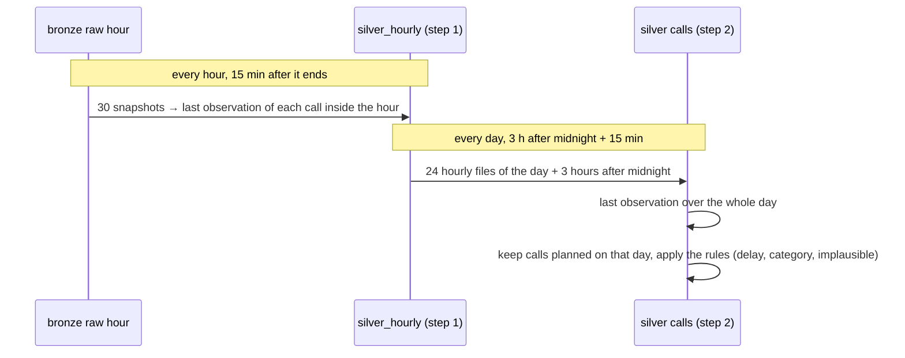

# ADR-0007: Silver grain: the last known state of each stop call

- **Status:** accepted
- **Date:** 2026-11-21

## Context

Silver turns bronze snapshots into rows ([ADR-0005](0005-silver-engine-duckdb.md): DuckDB). The same stop call is seen in **many** snapshots: the poller sees the same bus coming to the same stop every 2 minutes, and its expected time is updated each time. So silver must decide what **one row** means: its **grain**.

Measured on 2026-11-21 with one full hour (Nov 14, hour 18 UTC, 30 snapshots):

| | Value |
|---|---|
| observations (rows, one per snapshot × journey × stop) | **3,198,782** |
| distinct stop calls (journey, stop) | **204,513** |
| snapshots per call, on average | **15.6** |

One call followed over the whole hour (planned departure 19:24 UTC):

```
18:00 → 18:56   expected 19:24:00   delay 0 s    (29 snapshots)
18:58           expected 19:25:09   delay 69 s
19:xx           ...still seen in hour 19, until it leaves
```

Two things from this:
- **an hour before, a prediction is just the timetable** (delay 0). The real delay only shows close to departure
- the last state of a call is **not inside one hour**: this one leaves at 19:24, so its last observation is in hour 19

Silver rules already decided (Log, exercises 3 and 4): `delay_s = expected - aimed departure`; `NULL` when there is no aimed time, for `NO_REPORT` and `CANCELLED` (rows kept, cancellation rate); `NULL` + `implausible` when the **journey** median delay is above 60 min or below -10 min.

## Decision drivers

- Gold's first question: **median delay and cancellation rate per line and hour**: needs how late each bus **really** left
- Storage and speed on one VM (2 OCPU, 12 GB RAM)
- Kappa ([ADR-0001](0001-overall-data-architecture.md)): anything not stored in silver can be rebuilt from bronze by replay

## Options considered

### Option A: every observation (one row per snapshot × journey × stop)
- Pros: keeps how predictions change before departure (needed for Level 4, delay prediction)
- Cons: **~50 to 70 million rows a day** (3.2 million in one evening hour); gold would have to pick the last one anyway

### Option B: the last observation of each call (chosen)
- Pros: **1 row in ~16**; exactly what reliability needs; small, fast gold queries
- Cons: the "last observation" is the **best estimate**, not a certainty: a bus that drops out of the feed before leaving keeps its last prediction

### Option C: both, as two tables
- Pros: everything ready for Level 4
- Cons: pays the cost of A now for a need that does not exist yet

## Decision

Chosen option: **B, the last known state of each stop call**, because it is what reliability measures and it is ~16 times smaller. Option A is **not lost**: bronze keeps every snapshot (raw 7 days, then archives, [ADR-0006](0006-bronze-hourly-zstd-archives.md)), so Level 4 can rebuild it by **replay** when it needs it.

A call = **(journey_ref, stop_ref, aimed time)**, where aimed time = aimed departure, or aimed arrival when there is no departure (last stop).

### Two steps, because the last state crosses hours



- **Step 1, hourly:** `silver_hourly/date=YYYY-MM-DD/hour=HH/calls.parquet`: the last observation of each call within the hour
- **Step 2, daily:** `silver/calls/date=YYYY-MM-DD/calls.parquet`: the last observation over the day **plus 3 hours after midnight** (a call planned at 23:58 can be seen at 00:05), only calls **planned** on that day, rules applied
- One job (`silver.py`) run every hour finds by itself the hours and days that are ready and not done yet

## Consequences

- Positive: one row per call per day (~100,000 calls in one snapshot; the day's total to measure); gold reads small Parquet files
- Positive: verified on the real snapshot of Nov 14, 18:52 UTC: 100,760 calls, 56.7% measured, 31.1% no_aimed, 10.3% no_report, 1.1% cancelled, 0.5% implausible, 0.3% no_expected; 2.4 MB of Parquet
- Negative: silver must read a raw hour **while it is still raw** (7-day window, [ADR-0006](0006-bronze-hourly-zstd-archives.md)). Hours older than that need their archive unpacked first
- Negative: a call's final state is known only ~3 hours after the end of its day
- Risks: journeys that keep their ref across days (some operators reuse refs) could mix: the aimed time in the key and the "planned on that day" filter limit this

## Reversal trigger

- If Level 4 (delay prediction) needs the history of predictions, add Option A as a second table, rebuilt from bronze by replay
- If more than **1% of calls** a day are `implausible`, review the bounds before trusting that day

## After measurement

Fill in after the first full day: calls per day, Parquet size per day, step 1 and step 2 durations on the VM, category shares per day.

## Links

Related: Previous: [ADR-0006](0006-bronze-hourly-zstd-archives.md) · Engine: [ADR-0005](0005-silver-engine-duckdb.md)
